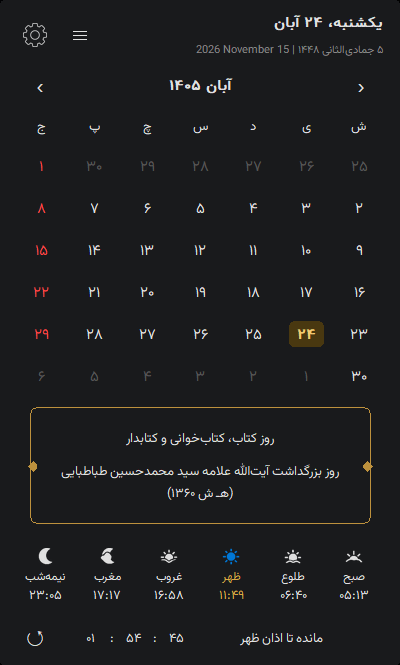
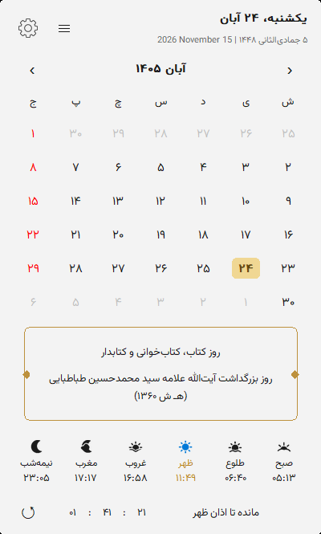
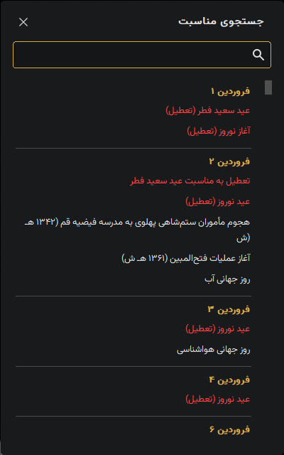
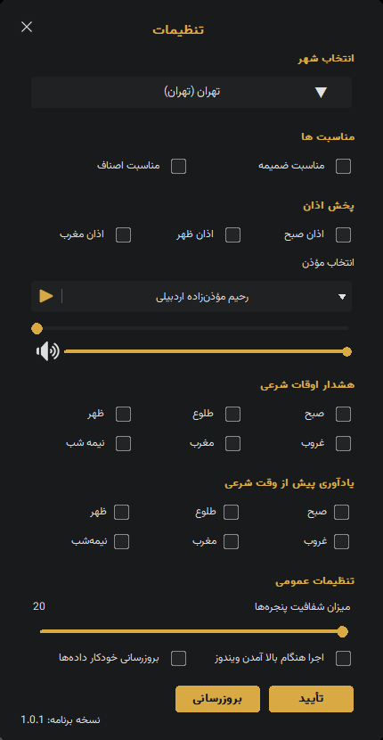
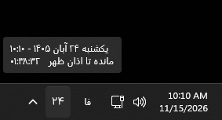

  <h1>RoozNegar</h1>
  
A Persian desktop calendar for Windows

  

    
    
    
  

  

*A Persian desktop calendar for Windows, featuring calendar dates, occasions, prayer times, and adhan playback.*

## Highlights

- Solar Hijri, Lunar Hijri, and Gregorian calendars.
- Official calendar occasions in primary, supplementary, and professions groups.
- Prayer times for 1,136 cities with valid coordinates.
- Nearly 40 muezzins, with configurable adhan playback, prayer-time alerts, and pre-prayer reminders.
- Lunar dates based on moon sighting, lightweight design, and independent data updates.

Program license and third-party notices: [LICENSE.txt](LICENSE.txt) | Full Vazirmatn font license: [Vazirmatn-OFL.txt](Vazirmatn-OFL.txt)

RoozNegar displays the Solar Hijri calendar alongside Gregorian and Lunar Hijri dates, occasions, and prayer times. It also provides adhan playback, configurable prayer-time alerts, and reminders before prayer times. The application is designed to present daily information in a simple, customizable, and lightweight environment.

> **Repository status:** This repository contains application release files and data used by the updater. The application source code is not published here.

## Operating system and requirements

The 64-bit version is built for and tested on Windows 10 and Windows 11. Earlier Windows versions have not been tested. The application bundles its Python runtime, so a separate Python installation is not required. An internet connection is needed to check for updates and download audio files.

## Screenshots

<table align="center">
  <tr>
    <td align="center"><strong>Main calendar - Dark</strong> </td>
    <td align="center"><strong>Main calendar - Light</strong> </td>
  </tr>
  <tr>
    <td align="center"><strong>Date converter</strong> </td>
    <td align="center"><strong>Occasion search</strong> </td>
    <td align="center"><strong>Settings</strong> </td>
    <td align="center"><strong>System tray</strong> </td>
  </tr>
</table>

## Features

- View the Solar Hijri calendar with corresponding Gregorian and Lunar Hijri dates, and navigate between days and months.
- View occasions in three groups: Primary, Supplementary, and Professions and Occupations. The latter two groups can be configured separately. Search occasions and jump directly to their calendar dates.
- Calculate prayer times for 1,136 cities with valid coordinates, with city and province selection.
- Choose from nearly 40 muezzins and configure adhan playback, prayer-time alerts, and pre-prayer reminders separately.
- Convert dates between the Solar Hijri, Gregorian, and Lunar Hijri calendars.
- Configure light or dark appearance, window transparency, launch at Windows startup, and system tray access.
- Update the application, calendar data, city coordinates, muezzin list, and adhan audio without replacing the user's personal data.

## Calendar data and sources

Lunar Hijri data begins in 1427 AH, corresponding to 1385 SH, and is based on moon sighting. Calendar and occasion data use a file prepared by the Calendar Council of the Institute of Geophysics, University of Tehran. Occasions are based on data approved by Iran's National Council of Public Culture. City coordinates are used to calculate prayer times.

## Prayer times

> **Notice:** Prayer times are calculated using the selected city's coordinates and the application's calculation method, then displayed to the nearest minute. Differences in coordinates, calculation methods, or rounding may cause slight differences from times announced by official sources. These times are a guide; for religious observance, consult a trusted source or follow the opinion of your marja.

Please report significant prayer-time discrepancies or inconsistencies between Lunar Hijri and Gregorian dates with the city name and relevant date.

## Download and run

Run the RoozNegar installer to install a published version. It places the application in `%LOCALAPPDATA%\Programs\RoozNegar`. If you have a folder-based test package, keep all contents of `RoozNegar` together and run `RoozNegar.exe` from that folder; its DLLs, libraries, font, and resources are required.

The initial settings window appears on first launch. Updatable data and user settings are kept in the local Windows profile so application updates do not replace them.

## Updates

The application may connect to the official project repository to check for or download Lunar Hijri calendar data, city coordinates, and muezzin list updates. Application files are in `RoozNegar/`, with the application manifest in the repository root. Calendar data and its update manifest are in `data/`; the audio index is `data/audio_update_index.json`, and audio files are in `adhan_audio/`.

During updates, versions and file details are compared with the manifests. Downloaded files are verified before replacement. User data, settings, and personal files remain in the local data directory.

## Bug reports and suggestions

When reporting a bug or suggestion, include the application version, Windows version, reproduction steps, and, if possible, a screenshot or error text. For calendar or prayer-time issues, include the city and date.

[Report an issue](https://github.com/mgh595/rooznegar-calendar/issues) | [GitHub](https://github.com/mgh595/rooznegar-calendar) | [LinkedIn](https://www.linkedin.com/in/mgh595/)

## Copyright and terms of use

© 2026 Mgh595. All rights reserved.

RoozNegar is proprietary freeware. Personal use of the executable is permitted. Copying, modifying, reverse engineering, or redistributing the application without the creator's written permission is prohibited. Third-party libraries, fonts, and other components are subject to their own licenses and terms; this notice does not replace them.

---

  <h1>روزنگار</h1>
  
تقویم فارسی ویندوز؛ تقویم، مناسبت‌ها، اوقات شرعی و پخش اذان

  <a href="https://github.com/mgh595/rooznegar-calendar/issues">گزارش مشکل</a>
  &nbsp;·&nbsp;
  <a href="https://github.com/mgh595/rooznegar-calendar">GitHub</a>
  &nbsp;·&nbsp;
  <a href="https://www.linkedin.com/in/mgh595/">LinkedIn</a>

## ویژگی‌های شاخص

✓ تقویم شمسی، قمری و میلادی 
✓ مناسبت‌های رسمی تقویم در گروه‌های اصلی، ضمیمه و اصناف 
✓ اوقات شرعی ۱۱۳۶ شهر دارای مختصات معتبر 
✓ نزدیک به ۴۰ مؤذن 
✓ دادهٔ قمری مبتنی بر استهلال 
✓ طراحی سبک و کم‌مصرف 
✓ بروزرسانی مستقل داده‌ها

مجوز برنامه و اطلاعیهٔ اجزای ثالث: [LICENSE.txt](LICENSE.txt) · مجوز کامل فونت وزیرمتن: [Vazirmatn-OFL.txt](Vazirmatn-OFL.txt)

روزنگار یک تقویم رومیزی فارسی برای ویندوز است که تقویم شمسی را در کنار تاریخ‌های میلادی و قمری، مناسبت‌ها و اوقات شرعی نمایش می‌دهد. پخش اذان، هشدارهای قابل‌تنظیم اوقات شرعی و یادآوری پیش از وقت هم در برنامه در دسترس‌اند. روزنگار با هدف ارائهٔ اطلاعات روزانه در محیطی ساده، قابل‌تنظیم و کم‌مصرف طراحی شده است.

> **وضعیت این مخزن:** این مخزن شامل فایل‌های انتشار برنامه و داده‌های موردنیاز برای بروزرسانی است. کد منبع برنامه در این مخزن منتشر نشده است.

## سیستم‌عامل و پیش‌نیازها

نسخهٔ ۶۴بیتی روزنگار برای Windows 10 و Windows 11 ساخته شده و روی هر دو آزمایش شده است. نسخه‌های قدیمی‌تر ویندوز آزمایش نشده‌اند. برنامه همراه با محیط اجرای Python بسته‌بندی شده و نصب جداگانهٔ Python لازم نیست. برای دریافت بروزرسانی‌ها و فایل‌های صوتیِ دانلودی، اتصال اینترنت نیاز است.

## قابلیت‌ها

- نمایش تقویم شمسی همراه با معادل میلادی و قمری و جابه‌جایی میان روزها و ماه‌ها.
- نمایش مناسبت‌ها در سه گروه «اصلی»، «ضمیمه» و «اصناف، حرفه‌ها و مشاغل کشور»؛ امکان تنظیم جداگانهٔ گروه‌های ضمیمه و اصناف، و جست‌وجوی مناسبت‌ها با رفتن مستقیم به تاریخ مربوط در تقویم.
- محاسبه و نمایش اوقات شرعی برای ۱۱۳۶ شهر دارای مختصات معتبر، همراه با انتخاب شهر و استان.
- انتخاب از میان نزدیک به ۴۰ مؤذن و تنظیم جداگانهٔ پخش اذان، هشدار اوقات شرعی و یادآوری پیش از وقت.
- تبدیل تاریخ میان تقویم‌های شمسی، میلادی و قمری.
- تنظیم ظاهر روشن یا تیره، شفافیت پنجره، اجرای برنامه هنگام راه‌اندازی ویندوز و دسترسی از سینی سیستم.
- بروزرسانی برنامه و داده‌های تقویم، مختصات شهرها، فهرست مؤذن‌ها و فایل‌های صوتی اذان، بدون جایگزینی اطلاعات شخصی کاربر.

## داده‌ها و منابع تقویم

داده‌های تاریخ قمری روزنگار از سال ۱۴۲۷ قمری، برابر با سال ۱۳۸۵ شمسی، بر پایهٔ استهلال تنظیم شده‌اند. فایل مبنای تقویم و مناسبت‌ها از فایل تنظیم‌شده توسط شورای مرکز تقویم مؤسسهٔ ژئوفیزیک دانشگاه تهران استفاده می‌کند.

مناسبت‌ها بر اساس داده‌های مصوب شورای فرهنگ عمومی کشور گردآوری شده‌اند و در گروه‌های اصلی، ضمیمه و اصناف، حرفه‌ها و مشاغل کشور ارائه می‌شوند. مختصات شهرها نیز برای محاسبهٔ اوقات شرعی به کار می‌روند.

## اوقات شرعی

> **توجه:** اوقات شرعی بر پایهٔ مختصات شهر انتخاب‌شده و روش محاسباتی برنامه به دست می‌آیند و به نزدیک‌ترین دقیقه نمایش داده می‌شوند؛ بنابراین ممکن است به‌دلیل تفاوت مختصات، روش محاسبه یا گردکردن، با زمان اعلام‌شده از سوی منابع رسمی اندکی اختلاف داشته باشند. این زمان‌ها جنبهٔ راهنما دارند؛ برای اطمینان از زمان شرعی، به منبع مورد اعتماد یا نظر مرجع تقلید خود مراجعه کنید.

اگر اختلاف زمانی قابل‌توجهی برای شهر خود دیدید، یا ناهماهنگی‌ای میان تاریخ‌های قمری و میلادی مشاهده کردید، لطفاً همراه با نام شهر و تاریخ مربوط گزارش دهید.

## دریافت و اجرای برنامه

برای نصب نسخهٔ منتشرشده، فایل نصب روزنگار را اجرا کنید. نصب‌کننده برنامه را در مسیر `%LOCALAPPDATA%\Programs\RoozNegar` قرار می‌دهد. اگر بستهٔ پوشه‌ای را برای آزمایش دریافت کرده‌اید، همهٔ محتویات پوشهٔ `RoozNegar` را کنار هم نگه دارید و `RoozNegar.exe` را از همان پوشه اجرا کنید؛ فایل‌های DLL، کتابخانه‌ها، قلم و منابع برای اجرای برنامه لازم‌اند.

در اجرای نخست، تنظیمات اولیهٔ برنامه نمایش داده می‌شود. داده‌های قابل‌تغییر و تنظیمات کاربر در مسیر محلی پروفایل ویندوز نگهداری می‌شوند تا بروزرسانی برنامه آن‌ها را جایگزین نکند.

## بروزرسانی‌ها

برنامه ممکن است برای بررسی یا دریافت بروزرسانی داده‌های تقویم قمری، مختصات شهرها و فهرست مؤذن‌ها به مخزن رسمی پروژه متصل شود.

فایل‌های انتشار برنامه داخل پوشهٔ `RoozNegar/` قرار دارند و مانیفست نسخهٔ برنامه در ریشهٔ مخزن نگهداری می‌شود. داده‌های تقویم و مانیفست بروزرسانی آن‌ها در `data/` قرار دارند. فهرست فایل‌های صوتی اذان نیز در `data/audio_update_index.json` و فایل‌های صوتی در `adhan_audio/` نگهداری می‌شوند.

هنگام بروزرسانی، نسخه و مشخصات فایل‌ها با مانیفست مقایسه می‌شوند. فایل‌های دریافت‌شده پیش از جایگزینی بررسی می‌شوند و داده‌ها، تنظیمات و فایل‌های شخصی کاربر در مسیر دادهٔ محلی او باقی می‌مانند.

## گزارش مشکل و پیشنهاد

برای گزارش خطا یا پیشنهاد، لطفاً نسخهٔ برنامه، نسخهٔ ویندوز، مراحل بازتولید مشکل و در صورت امکان تصویر یا متن خطا را بنویسید. برای ایرادهای مربوط به تقویم قمری یا اوقات شرعی، نام شهر و تاریخ موردنظر را نیز اضافه کنید.

## حق نشر و شرایط استفاده

© 2026 Mgh595. All rights reserved.

روزنگار نرم‌افزاری رایگان و اختصاصی است. استفاده از نسخهٔ اجرایی برای استفادهٔ شخصی مجاز است. کپی، تغییر، مهندسی معکوس و بازتوزیع برنامه بدون اجازهٔ کتبی سازنده مجاز نیست.

کتابخانه‌ها، قلم‌ها و سایر اجزای متعلق به اشخاص ثالث تابع مجوزها و شرایط استفادهٔ جداگانهٔ خود هستند؛ این اعلامیه جایگزین مجوزهای آن اجزا نیست.
