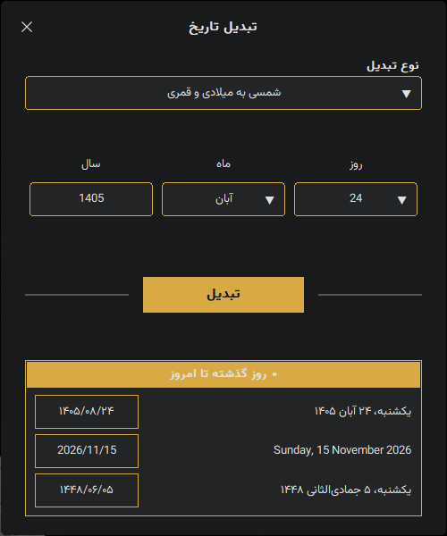

  <h1>روزنگار</h1>
  
تقویم فارسی ویندوز؛ تقویم، مناسبت‌ها، اوقات شرعی و پخش اذان

  

    
    
    
  

  

<table align="center">
  <tr>
    <td align="center"><strong>نمای اصلی · حالت تیره</strong> </td>
    <td align="center"><strong>نمای اصلی · حالت روشن</strong> </td>
  </tr>
</table>

  <a href="https://github.com/mgh595/rooznegar-calendar/issues">گزارش مشکل</a>
  &nbsp;·&nbsp;
  <a href="https://github.com/mgh595/rooznegar-calendar">GitHub</a>
  &nbsp;·&nbsp;
  <a href="https://www.linkedin.com/in/mgh595/">LinkedIn</a>

## ویژگی‌های شاخص

✓ تقویم شمسی، قمری و میلادی 
✓ مناسبت‌های رسمی تقویم در گروه‌های اصلی، ضمیمه و اصناف 
✓ اوقات شرعی ۱۱۳۶ شهر دارای مختصات معتبر 
✓ نزدیک به ۴۰ مؤذن 
✓ دادهٔ قمری مبتنی بر استهلال 
✓ طراحی سبک و کم‌مصرف 
✓ بروزرسانی مستقل داده‌ها

مجوز برنامه و اطلاعیهٔ اجزای ثالث: [LICENSE.txt](LICENSE.txt) · مجوز کامل فونت وزیرمتن: [Vazirmatn-OFL.txt](Vazirmatn-OFL.txt)

روزنگار یک تقویم رومیزی فارسی برای ویندوز است که تقویم شمسی را در کنار تاریخ‌های میلادی و قمری، مناسبت‌ها و اوقات شرعی نمایش می‌دهد. پخش اذان، هشدارهای قابل‌تنظیم اوقات شرعی و یادآوری پیش از وقت هم در برنامه در دسترس‌اند. روزنگار با هدف ارائهٔ اطلاعات روزانه در محیطی ساده، قابل‌تنظیم و کم‌مصرف طراحی شده است.

> **وضعیت این مخزن:** این مخزن شامل فایل‌های انتشار برنامه و داده‌های موردنیاز برای بروزرسانی است. کد منبع برنامه در این مخزن منتشر نشده است.

## سیستم‌عامل و پیش‌نیازها

نسخهٔ ۶۴بیتی روزنگار برای Windows 10 و Windows 11 ساخته شده و روی هر دو آزمایش شده است. نسخه‌های قدیمی‌تر ویندوز آزمایش نشده‌اند. برنامه همراه با محیط اجرای Python بسته‌بندی شده و نصب جداگانهٔ Python لازم نیست. برای دریافت بروزرسانی‌ها و فایل‌های صوتیِ دانلودی، اتصال اینترنت نیاز است.

## قابلیت‌ها

- نمایش تقویم شمسی همراه با معادل میلادی و قمری و جابه‌جایی میان روزها و ماه‌ها.
- نمایش مناسبت‌ها در سه گروه «اصلی»، «ضمیمه» و «اصناف، حرفه‌ها و مشاغل کشور»؛ امکان تنظیم جداگانهٔ گروه‌های ضمیمه و اصناف، و جست‌وجوی مناسبت‌ها با رفتن مستقیم به تاریخ مربوط در تقویم.
- محاسبه و نمایش اوقات شرعی برای ۱۱۳۶ شهر دارای مختصات معتبر، همراه با انتخاب شهر و استان.
- انتخاب از میان نزدیک به ۴۰ مؤذن و تنظیم جداگانهٔ پخش اذان، هشدار اوقات شرعی و یادآوری پیش از وقت.
- تبدیل تاریخ میان تقویم‌های شمسی، میلادی و قمری.
- تنظیم ظاهر روشن یا تیره، شفافیت پنجره، اجرای برنامه هنگام راه‌اندازی ویندوز و دسترسی از سینی سیستم.
- بروزرسانی برنامه و داده‌های تقویم، مختصات شهرها، فهرست مؤذن‌ها و فایل‌های صوتی اذان، بدون جایگزینی اطلاعات شخصی کاربر.

## داده‌ها و منابع تقویم

داده‌های تاریخ قمری روزنگار از سال ۱۴۲۷ قمری، برابر با سال ۱۳۸۵ شمسی، بر پایهٔ استهلال تنظیم شده‌اند. فایل مبنای تقویم و مناسبت‌ها از فایل تنظیم‌شده توسط شورای مرکز تقویم مؤسسهٔ ژئوفیزیک دانشگاه تهران استفاده می‌کند.

مناسبت‌ها بر اساس داده‌های مصوب شورای فرهنگ عمومی کشور گردآوری شده‌اند و در گروه‌های اصلی، ضمیمه و اصناف، حرفه‌ها و مشاغل کشور ارائه می‌شوند. مختصات شهرها نیز برای محاسبهٔ اوقات شرعی به کار می‌روند.

## اوقات شرعی

> **توجه:** اوقات شرعی بر پایهٔ مختصات شهر انتخاب‌شده و روش محاسباتی برنامه به دست می‌آیند و به نزدیک‌ترین دقیقه نمایش داده می‌شوند؛ بنابراین ممکن است به‌دلیل تفاوت مختصات، روش محاسبه یا گردکردن، با زمان اعلام‌شده از سوی منابع رسمی اندکی اختلاف داشته باشند. این زمان‌ها جنبهٔ راهنما دارند؛ برای اطمینان از زمان شرعی، به منبع مورد اعتماد یا نظر مرجع تقلید خود مراجعه کنید.

اگر اختلاف زمانی قابل‌توجهی برای شهر خود دیدید، یا ناهماهنگی‌ای میان تاریخ‌های قمری و میلادی مشاهده کردید، لطفاً همراه با نام شهر و تاریخ مربوط گزارش دهید.

## دریافت و اجرای برنامه

برای نصب نسخهٔ منتشرشده، فایل نصب روزنگار را اجرا کنید. نصب‌کننده برنامه را در مسیر `%LOCALAPPDATA%\Programs\RoozNegar` قرار می‌دهد. اگر بستهٔ پوشه‌ای را برای آزمایش دریافت کرده‌اید، همهٔ محتویات پوشهٔ `RoozNegar` را کنار هم نگه دارید و `RoozNegar.exe` را از همان پوشه اجرا کنید؛ فایل‌های DLL، کتابخانه‌ها، قلم و منابع برای اجرای برنامه لازم‌اند.

در اجرای نخست، تنظیمات اولیهٔ برنامه نمایش داده می‌شود. داده‌های قابل‌تغییر و تنظیمات کاربر در مسیر محلی پروفایل ویندوز نگهداری می‌شوند تا بروزرسانی برنامه آن‌ها را جایگزین نکند.

## بروزرسانی‌ها

برنامه ممکن است برای بررسی یا دریافت بروزرسانی داده‌های تقویم قمری، مختصات شهرها و فهرست مؤذن‌ها به مخزن رسمی پروژه متصل شود.

فایل‌های انتشار برنامه داخل پوشهٔ `RoozNegar/` قرار دارند و مانیفست نسخهٔ برنامه در ریشهٔ مخزن نگهداری می‌شود. داده‌های تقویم و مانیفست بروزرسانی آن‌ها در `data/` قرار دارند. فهرست فایل‌های صوتی اذان نیز در `data/audio_update_index.json` و فایل‌های صوتی در `adhan_audio/` نگهداری می‌شوند.

هنگام بروزرسانی، نسخه و مشخصات فایل‌ها با مانیفست مقایسه می‌شوند. فایل‌های دریافت‌شده پیش از جایگزینی بررسی می‌شوند و داده‌ها، تنظیمات و فایل‌های شخصی کاربر در مسیر دادهٔ محلی او باقی می‌مانند.

## گزارش مشکل و پیشنهاد

برای گزارش خطا یا پیشنهاد، لطفاً نسخهٔ برنامه، نسخهٔ ویندوز، مراحل بازتولید مشکل و در صورت امکان تصویر یا متن خطا را بنویسید. برای ایرادهای مربوط به تقویم قمری یا اوقات شرعی، نام شهر و تاریخ موردنظر را نیز اضافه کنید.

## حق نشر و شرایط استفاده

© 2026 Mgh595. All rights reserved.

روزنگار نرم‌افزاری رایگان و اختصاصی است. استفاده از نسخهٔ اجرایی برای استفادهٔ شخصی مجاز است. کپی، تغییر، مهندسی معکوس و بازتوزیع برنامه بدون اجازهٔ کتبی سازنده مجاز نیست.

کتابخانه‌ها، قلم‌ها و سایر اجزای متعلق به اشخاص ثالث تابع مجوزها و شرایط استفادهٔ جداگانهٔ خود هستند؛ این اعلامیه جایگزین مجوزهای آن اجزا نیست.

## اسکرین‌شات‌ها

برای دیدن اندازهٔ کامل هر تصویر، روی آن کلیک کنید.

<table>
  <tr>
    <td align="center">
<strong>تبدیل تاریخ</strong>
</td>
    <td align="center">
<strong>جست‌وجوی مناسبت‌ها</strong>
</td>
  </tr>
  <tr>
    <td align="center">
<strong>تنظیمات برنامه</strong>
</td>
    <td align="center">
<strong>نمای سینی سیستم</strong>
</td>
  </tr>
</table>
